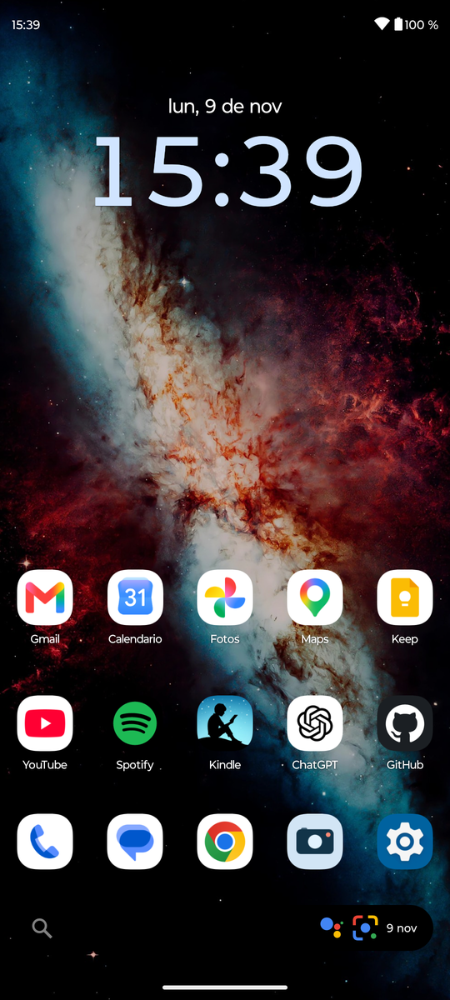
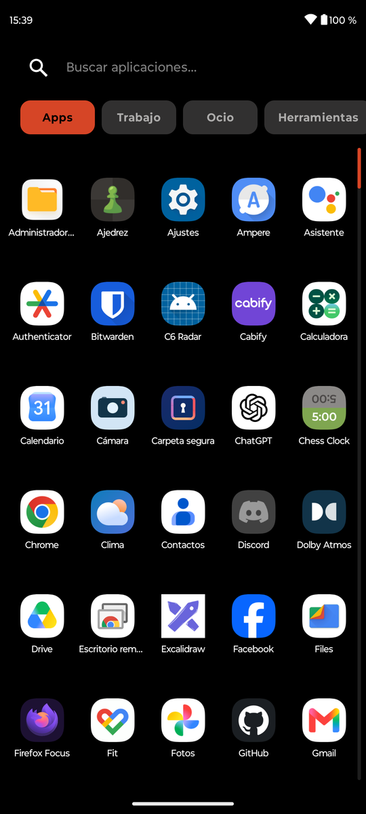
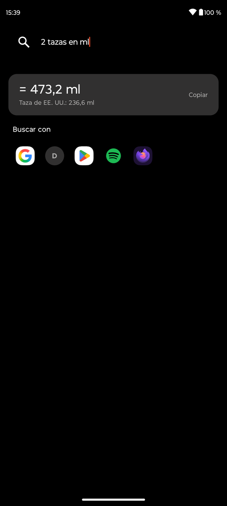
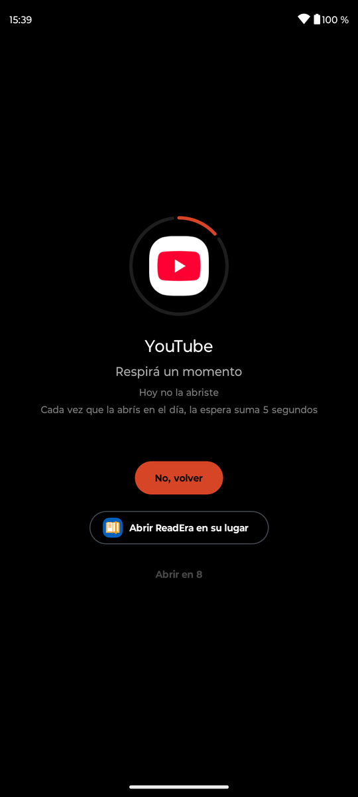
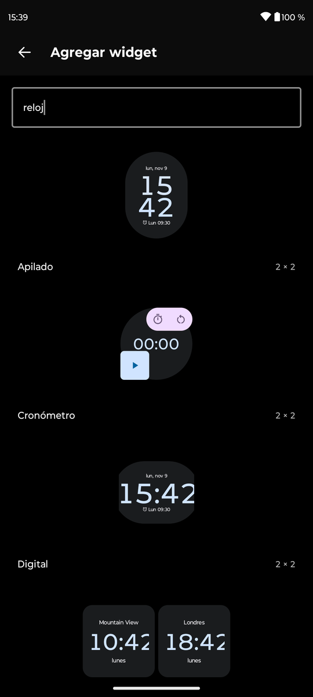
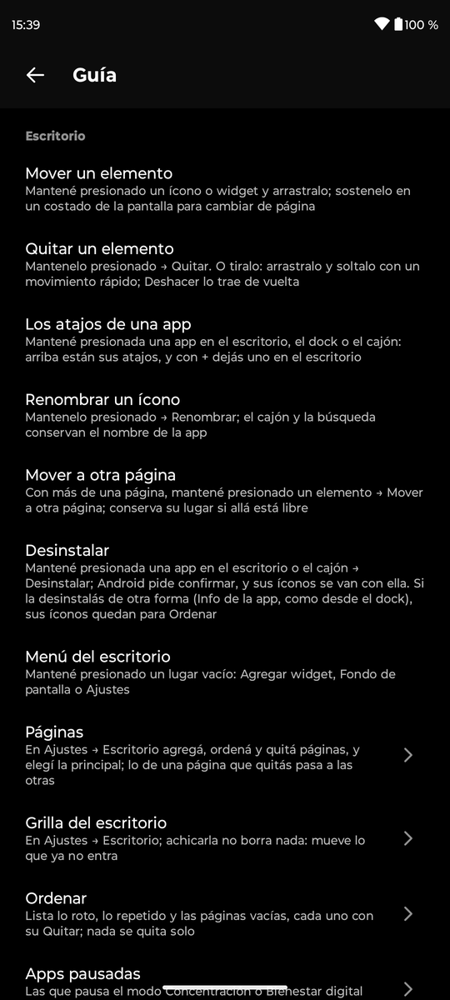

<p align="center">
  
</p>

<h1 align="center">Islauncher</h1>

<p align="center">
  <strong>The home screen that sees every app you open, and has no way to tell anyone.</strong><br>
  Nova-style control for Android 13 and newer, with no network permission at all.
</p>

<p align="center">
  <a href="https://github.com/gastoncampana/islauncher/releases/latest"></a>
  
  
  <a href="LICENSE"></a>
</p>

<p align="center">
  
  
  
</p>
<p align="center">
  
  
  
</p>

## Why Islauncher

A launcher knows which apps you have, which you open and when. Islauncher ships without Android's INTERNET
permission, so that knowledge has nowhere to go: no analytics, no crash reporting, no accounts. You can
[check any build yourself](#privacy).

- **Your layout, your way.** Desktop pages on a half-cell grid, a swipeable dock, drawer tabs, gestures, widgets you
  resize with a frame, and items you throw off the screen to remove.
- **Search that answers.** Sums, percentages and offline unit conversion. Phone numbers, links and e-mail addresses
  become actions. Apps you use more rise to the top, and that score never leaves the phone.
- **Poisons.** Mark the apps that eat your time, and they open only after a pause that grows with each open that day.
- **Move in from Nova.** Import a `.novabackup` with your pages, dock, tabs and hidden apps.
- **Backups stay on the phone.** Save the layout by hand or weekly, to local storage only.
- **Nothing to discover by accident.** Settings → Guide shows what every part of the app can do.

Available in English and Spanish. It follows the system language, or the language picked for it in Android's per-app
language settings (Settings → System → Languages → App languages, or the app's info page; the names vary by phone).

## Install

1. Download `islauncher-<version>.apk` from the [latest release](https://github.com/gastoncampana/islauncher/releases/latest).
2. Open it on the phone and allow installs from that app when Android asks. Play Protect may warn you, because the app
   does not come from Google Play.
3. Press Home and pick Islauncher, then "Always". The launcher's own settings also have a row for this.

Moving from Nova? Export a backup there, then import it from Settings → Backup in Islauncher.

**Verify the download (optional).** Each release lists the APK's SHA-256. Every published APK is signed with the same
key, whose certificate has this SHA-256 fingerprint:

```text
47:CE:49:C4:FB:CA:EC:15:54:92:77:5B:3E:18:05:F4:E0:EF:29:C3:B0:00:EB:39:53:4E:22:DF:8C:04:E9:8F
```

Compare it with `apksigner verify --print-certs islauncher-<version>.apk`, which prints it without the colons.

## Privacy

A launcher sees every app you have and every app you open, so this one is built so that it cannot leak that:

- **No INTERNET permission.** `src/main/AndroidManifest.xml` declares `android.permission.INTERNET` with
  `tools:node="remove"`, which strips it from the merged manifest even when a library asks for it. Without that
  permission Android gives the app no network sockets.
- **Check any build yourself:**
  `apkanalyzer manifest permissions islauncher-<version>.apk` (apkanalyzer comes with the Android SDK command-line
  tools). It lists the four permissions under [Permissions](#permissions), and INTERNET is not one of them.
- **No cloud backup.** `android:allowBackup="false"` keeps the app's data out of Android's cloud backup. Since
  Android 12 that setting does not stop a device-to-device transfer, so setting up a new phone from this one can
  copy the layout across.
- **Layout backups stay local.** Manual and weekly backups are written through the system file picker with
  `EXTRA_LOCAL_ONLY`, so cloud providers are not offered as a destination. A local folder that another app syncs
  is still synced by that app.
- **"Search with" hands your query to the app you tap.** The launcher itself sends nothing. So do the actions
  search offers on a phone number, link or e-mail address: the number, link or address goes to the app you tap,
  and nothing you type is stored.
- **The number format reads the phone's country.** Set to automatic, it takes the country of the SIM card, else of
  the mobile network, else of the language settings. Android gives that without a permission, and it stays on the
  device.
- **Opening an app passes it nothing about the launcher.** No icon position (Android's source bounds) and no
  animation options go with it.
- **App shortcuts are read only to show them.** Each time an app's menu opens, it asks Android for that app's
  shortcuts, which can name recent chats, and keeps none of them. A shortcut you add to the home screen keeps its
  label and icon, as any pinned shortcut does. The drawer also reads installed browser web shortcuts pinned to
  Islauncher. It keeps their icons and records which web app identities it has already placed on Home, so removing
  an icon is respected on later refreshes. That discovery record stays on the device and is not part of a layout backup.
- **Search learns from your opens, on the device only.** The launcher keeps a score per app of how often and how
  recently you opened it. The score loses a tenth of its weight each day: an app opened once drops out after about
  six weeks, one you opened every day a couple of months after you stop. Poison apps never gain a score: only the day
  of their last open is kept, for "Not opened in a while". The scores
  are kept apart from the layout, so neither the manual nor the weekly backups carry them (a device-to-device
  transfer can copy them, as it can the layout). Each score keeps the day of its app's last open, for at least 60
  days, and the launcher notes the day it began counting: "Not opened in a while" reads both.
- **Everything else stays in the app's private storage.** That covers the layout (JSON in SharedPreferences),
  today's open counts for poison apps (older days are dropped), the search use scores, the weekly backup folder and
  the icons of pinned shortcuts. Uninstalling deletes all of it, but not the backup files you saved elsewhere.

## Features

<details>
<summary><strong>Home screen</strong></summary>

- Desktop pages with apps, shortcuts and widgets on a grid that places items in half-cell steps.
- Long-press an item for its menu (an app's shortcuts, app info, uninstall and remove, plus "resize" and "set up
  again" on a widget), or drag it to move it. Uninstall opens Android's own confirmation, and system apps do not offer it. Once
  the app is gone, its icons on the desktop and in the dock go too; its widgets stay for Tidy up.
  Holding a dragged item at the side of the screen flips to the page on that side.
- Throw a dragged item off the screen to remove it: let go of it with a quick flick and it flies off. A bar then
  offers Undo for about four seconds (longer when an accessibility service asks for more time), which puts the item
  back in its spot, or in the nearest free one if that was taken meanwhile. An undone widget is the same widget, with
  no setup. A slow release drops the item as usual, an app let go over the dock goes into it however fast, and
  throwing an app dragged out of the drawer only cancels it.
- A widget's menu can resize it, unless its app gives it a fixed size. A frame appears over it, with a handle on each
  side its app lets it stretch. Dragging a handle moves that side in half-cell steps, with a light tick each, as far
  as the widget's app, the page and the items around it allow, and the widget takes its new size when you let go.
  Tap outside the frame, or press Back or Home, when done.
- The menu also moves an item to another page, picked from a list that marks the main page. The item keeps its spot
  there if it is free, else it takes the nearest free one, and if the page has no room a message says so.
- An icon can be renamed from its menu. The new name is that icon's only: the drawer and search keep the app's name.
- Long-press an empty spot to add a widget, change the wallpaper or open the settings.
- Icons on the desktop, in the dock and in the drawer shrink a little under your finger and spring back.
- Widgets come from a searchable picker, grouped by app, that shows each widget's preview and size in cells. The
  preview is the one its app generates (Android 15+, once the launcher may bind widgets), else its preview layout,
  else its preview image. A widget takes the size its app asks for, fitted to the grid, at the first free spot of the
  page. If it needs setup, its setup screen runs when you add it.
- Gestures:
  - Swipe up opens the app drawer.
  - Swipe down opens the notification shade.
  - Double tap opens an app of your choice, set in Settings → Gestures.
- The Home button closes whatever is open (a menu, the drawer, Settings). With nothing open on the home screen, it
  goes back to the main page, and pressing it on the main page opens search.
- The search bar has buttons for the voice assistant and Google Lens, and shows today's date, which opens your
  calendar. There is no weather, because it would need the network. Settings → Home screen → Search bar hides it,
  and the desktop takes its space; a swipe up still opens the drawer and its search.
- Apps paused by Focus mode or a Digital Wellbeing limit are greyed out. Settings → Home screen → Paused apps can
  hide them instead: they leave the desktop, the dock and the drawer tabs, keeping their place, and come back when
  the pause ends. Search still shows them, greyed out, and one dragged from there is placed out of sight, with a
  message saying so.

</details>

<details>
<summary><strong>Dock</strong></summary>

- Settings → Dock → Show dock hides the whole dock: the desktop takes its space, and its icons are kept for when it
  comes back.
- Several dock pages, which wrap around from the last page to the first (you can turn that off).
- One dock page is the main one, marked with a house in Settings → Dock. The dock starts on it and goes back to it
  whenever you leave the home screen, such as after opening an app.
- Each icon opens one app on tap and can open other apps on a swipe up or down. Long-press a slot for its menu: the
  app's shortcuts, Configure and app info (a slot with no app goes straight to Configure). Configure shows what the tap
  and each swipe open, and its app picker brings you back to it, so all three can be set in one go. An icon without its own swipe actions opens the drawer or
  the notification shade, as a swipe does elsewhere on the home screen.
- Drop an app from the drawer or the desktop onto an empty dock slot.

</details>

<details>
<summary><strong>App drawer and search</strong></summary>

- Tabs, swiped sideways like pages:
  - an all-apps tab, plus tabs of apps you pick
  - a picked tab can take its apps out of the all-apps tabs, as new tabs do by default
  - long-press a tab to rename it, add a tab or remove a picked one; the settings also reorder them, and pick a
    tab's apps from a list of all apps, which a new tab opens right after its name
- Hidden apps are left out of every tab, but search still finds them.
- Installed Chromium WebAPKs and browser web shortcuts accepted by Islauncher appear in the drawer and search.
  They are added to Home once, without moving existing icons; a full desktop gets another page. Removing a Home
  icon does not remove the drawer entry or cause it to be added back on each refresh. Web shortcuts open their
  own destination, can be dragged to Home or the dock, and can be assigned to tabs or hidden independently.
  Their menus do not offer to uninstall the browser. Android does not expose another launcher's private pinned
  shortcuts: add those again from the browser if they are missing.
- Accent-insensitive search that ranks prefix matches first. Among equally good matches, the apps you open more
  often and more recently come first, so `s` and Go opens the app you use, not a rarely used one. The keyboard's Go
  key opens the first result. Without a query the tabs stay alphabetical.
- A calculator: a query that is a sum, such as `125*3` or `(2+3)^2`, shows its result, and tapping the result copies
  it. It handles `x × ÷ ^ %` and parentheses, and a percentage added or taken off is of what comes before it:
  `1500 + 21%` is 1815.
- Numbers are read and shown the way your country writes them: in Argentina `1.500.000/12` is `125.000` and
  `1.500,50 + 200` is `1.700,5`. A lone mark of the other kind is a decimal point unless it groups thousands (one to
  three digits, not a 0, then three after it), so `1.5`, `0.500` and `1234.567` still read 1,5, 0,5 and 1234,567 there. Settings → App drawer can fix the format to `1.234,5` or `1,234.5` instead.
- Unit conversion, offline: `5 km a mi`, `350 f`, `2 tazas en ml`, `100 km/h to mph` show the result, which a tap
  copies. Without a target unit (`70 kg`) it converts to the metric or imperial counterpart. It knows length, mass,
  volume, temperature, speed and area, in Spanish and English. `m` is the metre, `oz` the ounce of mass (`fl oz` is
  the fluid one, as `oz` is next to a volume: `8 oz a ml`) and a cup is the US cup (236.6 ml), which the answer points out. There are no currencies, because
  they would need the network.
- A phone number, typed or pasted, offers Call (it opens the dialer with the number, which dials nothing by
  itself), WhatsApp (if installed) and SMS. A link offers Open, unless an app matches too (`booking.com`), and an
  e-mail address Write. A number needs 8 to 15 digits, alone (`1155559999`), after a `+`, or with spaces, dashes or
  parentheses between its groups, so `1500000-250000` is still a sum.
- A "search with" row that hands the query to Google, DuckDuckGo, Play Store, Spotify or Firefox Focus.
- A fast scroller. Pulling down at the top of the list closes the drawer.
- Each app's menu lists its shortcuts and can add it to the desktop, toggle its tabs, hide it, mark it as a poison,
  open its app info or uninstall it (not a system app). You can also drag an app onto the desktop or the dock.

</details>

<details>
<summary><strong>Poisons</strong></summary>

- Apps you mark as poisons open only after a pause: 10 seconds, plus 5 seconds for each time you already opened that
  app today. The pause screen shows today's count, and "go back" is the main button.
- You can pick one healthy app in Settings → App drawer, such as a reading or habits app. The pause screen then
  offers it under "go back" as "Open <app> instead", with no wait. If that app is a poison too, it gets its own pause.
- The pause applies to every way the launcher opens an app: the drawer, desktop and dock icons, swipes, double tap,
  shortcuts on the desktop and in app menus, search providers and the search bar buttons.

</details>

<details>
<summary><strong>Shortcuts</strong></summary>

- An app's menu (long-press it on the desktop, in the dock or in the drawer) starts with up to four of its shortcuts,
  as in Nova, such as "New message", a recent chat or "Scan QR code". Tap one to open it, or its + to add it to the
  home screen, where it goes on the main page or the first page with room. The shortcuts the app always offers come
  first, but up to two of those it adds as you use it, such as recent chats, still make the list.
- Supports "Add to home screen" from other apps, such as a browser's web shortcuts, while this is the default home
  app. You confirm each one, because any app in the foreground can send the request. It goes on the main page, or
  the first page with room.
- Shortcuts carry the badge of their app, except browser shortcuts, which come with a badge of their own.

</details>

<details>
<summary><strong>Settings</strong></summary>

- Settings → Guide lists what the app can do, part by part, each entry with how to do it; an entry with settings of
  its own opens them. It opens by itself once, on the first launch of a fresh install, and never for a layout already
  in use.
- You can set the desktop grid, the drawer grid (its columns and how many rows fit on screen) and the number of dock
  icons per page, each from 2 to 12.
- Shrinking the desktop grid never deletes anything. Items that no longer fit move to the nearest free spot, or to
  another page, or to a new page, and the grid dialog says how many will move before you apply it. Fewer dock icons
  per page hide the ones past the new size, kept until the dock grows again.
- Desktop pages can be added, removed (their items move to other pages), reordered and set as the main page, which
  stays the main one wherever it moves. Dock pages can be added, reordered, removed and set as the main page the same
  way; removing one deletes its icons, after asking. The desktop and the dock take up to 20 pages each.
- Settings → Home screen → Tidy up lists what needs a look, and its row counts the broken items and empty pages
  (duplicates may be on purpose, so they are listed but not counted):
  - icons, dock taps and swipes whose app is uninstalled, shortcuts whose app is gone, and widgets whose app is gone
    (a widget waiting to be set up after a Nova import is not broken)
  - an app on more than one page, or in the dock and on a page
  - empty pages

  Each entry says where it is and has its own Remove. "Remove everything broken" removes only the broken ones, after
  asking, never the duplicates or the pages. Nothing is removed on its own. An app in a paused work profile, or one
  being updated, is not listed as broken.
- The drawer section reorders, renames and removes tabs, sets whether a picked tab leaves the all-apps tabs, and
  lists the hidden apps and the poisons to tick or untick. It also picks the app the pause offers instead and the
  number format of search (automatic, `1.234,5` or `1,234.5`).
- Settings → App drawer → Not opened in a while lists the apps you have not opened from the launcher in 60 days and
  installed at least that long ago, each with Uninstall. System apps, poisons, apps with a widget on the desktop and
  work profile apps are left out. The launcher began counting opens with this feature's release (or up to six weeks
  before, as far as the search scores it already had show), so until then the row says the date the list is ready.
  These are only candidates: see [Known limitations](#known-limitations).
- Haptic feedback (on by default, switch in Settings → Gestures): a light vibration on long presses, drops (a
  different one when there is no room), throws, each step of a widget's resize, swipe gestures, the double tap and
  settings controls. The phone's own touch
  vibration setting still applies.

</details>

<details>
<summary><strong>Backups</strong></summary>

- Manual backups: save the whole layout (desktop, dock, tabs, hidden apps, poisons and settings) to a JSON file, or
  restore it from one. Restoring replaces the current layout.
- Weekly backups go to a folder you choose. The first copy is written right away, and then one whenever you come
  back to the home screen and seven days have passed since the last one, so no background scheduler is needed. A
  failed copy is retried the next day. Each copy is a new dated file; old ones are not deleted.
- Nova Launcher import from a `.novabackup` file. It replaces the current layout and brings in:
  - dock pages with their swipe actions
  - desktop pages with their apps, shortcuts and widgets
  - drawer tabs and hidden apps
  - grid sizes (except the drawer's rows), the main page, the double-tap gesture and dock wrap-around

  Your poisons, the app the pause offers instead, the haptic feedback setting, the number format, the paused apps
  setting and whether the dock and the search bar show are kept.

</details>

## Building from source

The app is written in Kotlin with Jetpack Compose and depends only on AndroidX (Compose Material 3, Activity, Core).
You need JDK 21 (a full JDK, because the build needs `javac`) and the Android SDK with platform 37. Gradle comes with
the wrapper.

1. Point the build at the SDK, either with `ANDROID_HOME` or with `sdk.dir` in `local.properties`. Android Studio
   writes that file, and git ignores it.
2. If the default `java` is not a JDK 21 with `javac`, set `JAVA_HOME` to one.
3. Run the build or the tests:

```sh
./gradlew assembleRelease     # writes build/outputs/apk/release/islauncher-release.apk
./gradlew testDebugUnitTest   # unit tests: layout model, search and its answers, Nova converter
```

The build downloads Gradle and the dependencies. The app it produces has no network access.

**Signing:** release builds are minified with R8. Without the key of the published APKs, they are signed with your
machine's debug key (`~/.android/debug.keystore`, which the Android build tools create on first use). That means:

- **A build of your own does not update a published APK, or the reverse.** Android installs an update only over an
  app signed with the same key, so switching means uninstalling first.
- **Uninstalling wipes the layout.** Save a backup first and restore it after reinstalling. Pinned shortcuts do not
  come back that way (see [Known limitations](#known-limitations)).

To put your own build on a phone for the first time, run `adb install build/outputs/apk/release/islauncher-release.apk`.
For updates, with USB debugging on and the phone connected:

```sh
scripts/install.sh
```

The script needs `adb` on the `PATH` and a single connected phone. It builds the release APK, stops the running
launcher, installs the update and checks that the launcher is still the default home app. If the launcher is on
screen, it first brings up Settings, so Android does not restart it during the install, and goes back home after.

It exists because an update that kills the running home app can make Android drop the "always" home choice. The app
keeps the home role, but the next Home press asks which launcher to use. Stopping the app first avoids that. If the
choice is lost anyway, the script says so, and you pick the launcher again with "Always". `./gradlew installRelease`
does not stop the app first, so it can lose the choice.

## Making it the default home app

- Press Home and pick Islauncher, then "Always".
- Or go to Settings → Apps → Default apps → Home app. The names vary by manufacturer.
- The launcher's own settings (long-press an empty spot on the desktop) have a row that opens that system screen.

Shortcuts (pinned ones and those imported from Nova) open only while this is the default home app, and app menus
list shortcuts only then, because Android allows that only for the default home app.

## Permissions

These are the permissions `apkanalyzer manifest permissions` lists for a release build:

| Permission | Why |
|---|---|
| `android.permission.QUERY_ALL_PACKAGES` | Lists every installed app and every widget provider. That includes widget receivers that are not exported, which a `<queries>` block misses. Seeing every app is why the no-network rule matters. |
| `android.permission.EXPAND_STATUS_BAR` | Swiping down opens the notification shade. |
| `android.permission.REQUEST_DELETE_PACKAGES` | Uninstall in app menus and in "Not opened in a while". It only opens Android's own confirmation, which removes nothing until you accept. Granted at install. |
| `io.github.gastoncampana.launcher.DYNAMIC_RECEIVER_NOT_EXPORTED_PERMISSION` | Added by AndroidX Core for its receiver helper on older Android versions. It is a signature permission, and nothing in this app is guarded by it. |

There are no runtime permission prompts. Adding a widget may show Android's own dialog asking whether the launcher
may create widgets.

## Known limitations

- **Poisons only pause opens that go through the launcher.** An app opened from a notification, from Recents, or
  picked inside a system chooser (such as the wallpaper chooser) opens right away.
- **Search learns only from opens through the launcher.** An app opened from a notification or from Recents does
  not move up in search.
- **"Not opened in a while" sees only opens through the launcher too.** An app you open only from its
  notifications, from Recents or from a link in another app (a chat app, say) can be listed although you use it, so
  check before uninstalling. Work profile apps are not listed, because Android gives the launcher only the main
  profile's install dates; nor is any app whose install date cannot be read.
- **Shortcuts that Nova pinned belong to Nova.** After an import they appear but do not open, so add them again from
  the app's menu or from the app itself.
- **Pinned shortcuts do not survive a reinstall.** They belong to the install that pinned them, and backups do not
  carry their icons. After restoring, add them again from the app's menu or from the app itself.
- **Some widgets start as placeholders.** This happens after a Nova import, and after restoring a backup whose
  widgets no longer exist on the device. Tap each placeholder to bind it and run its setup.
- **There are no folders.** A Nova import skips Nova's folders, its private-space tab and Nova's own actions, such as
  "open drawer".
- **App menus list shortcuts only for the main profile.** A work profile app's menu lists none, and a shortcut in a
  menu is added with its +, not dragged out as in Nova.
- **No icon packs.** A Nova import keeps the labels the icons had in Nova.
- **Tidy up looks at the desktop and the dock icons shown.** Dock icons hidden by a smaller dock, the double-tap
  app and the app offered instead of a poison are not checked. An app that is installed but disabled is not listed
  as broken.
- **Other apps can pin shortcuts, but not widgets.**
- **Apps open with Android's own animation, not out of their icon.** From the December 2024 Android 15 update on,
  only a home app with a system permission picks the open animation, and the Pixel launcher's morph from icon to
  window and back needs one too.
- **The screen does not rotate.** It stays in the phone's natural orientation.
- **The "search with" providers and the Lens button are fixed.** The Lens button needs the Google Lens app.
- **Phone numbers are recognised by their shape.** Two groups joined by a single dash, such as `4555-1234`, read as
  a subtraction: type the area code or a space. Dashes alone read as one too when a group has five digits or more
  without a leading 0 (`25000-7500-1500`), and a day and month before a year (`29-10-2024`) are no phone number. A
  chain of short groups, such as `1500-200-3000`, still reads as one. Without a `+`, the last group must have four digits, as in
  Argentina and North America. WhatsApp gets the international form of the number, with the mobile 9 added for
  Argentina; WhatsApp Business is not offered.
- **Swipe down depends on a non-public Android API.** There is no public way to open the notification shade, so a
  future Android version may block it.

## Project layout

Kotlin sources are in `src/main/kotlin/io/github/gastoncampana/launcher/`, and the tests are in the matching
`src/test/kotlin/` folder.

| File | Contents |
|---|---|
| `build.gradle.kts`, `settings.gradle.kts`, `gradle.properties` | The single Gradle module and its AndroidX dependencies. |
| `src/main/AndroidManifest.xml` | Permissions (INTERNET removed), the home activity and the pinned-shortcut activity. |
| `src/main/res/values/`, `src/main/res/values-es/` | UI strings: English (the default) and Spanish. |
| `src/main/res/resources.properties` | Names English as the default locale for the generated per-app language list. |
| `Model.kt` | Pure logic: the layout model, grid placement, JSON persistence, app lookup, search and its answers (calculator, unit conversion, phone numbers, links and addresses), which shortcuts an app's menu lists and which apps count as not opened in a while. |
| `Nova.kt` | A pure converter from a Nova backup's database rows and preferences to a layout. |
| `NovaImport.kt` | Reads the `.novabackup` zip (`nova.db` and `nova.xml`). |
| `Launcher.kt` | The home activity (app list, app shortcuts, widget hosting, opening and uninstalling apps, poisons, use scores, backups, Nova import), the shared layout state and `PinActivity` for pinned shortcuts. |
| `Ui.kt` | The Compose UI: desktop, dock, search bar, drawer, menus and dialogs, the pause screen and the settings. |
| `ModelTest.kt`, `NovaTest.kt` | Unit tests for the model and the Nova converter. |
| `scripts/install.sh` | Builds and installs an update over adb without losing the default home choice. |
| `scripts/release.sh` | Builds the APK for a release: runs the tests and checks the signature and the permissions. |
| `CLAUDE.md` | Invariants and architecture notes for contributors and coding agents. |

## License

MIT, see [LICENSE](LICENSE). Islauncher is not affiliated with or endorsed by Nova Launcher or its developers.
